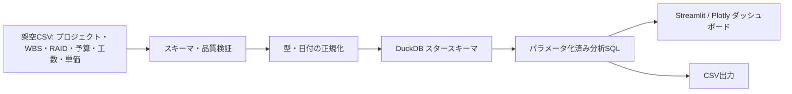

# BIアーキテクチャ

## 目的と全体像

このBI機能は、PM・PMOの管理台帳を分析しやすい形に変換し、進捗・予算・工数・リスク・課題を同じ基準日で確認するためのローカル完結型サンプルです。入力値はすべて架空であり、外部サービスやクラウドへの送信は行いません。

## コンポーネント

| 層 | 実装 | 責務 |
| --- | --- | --- |
| 入力 | `bi/data/source/*.csv` | 再現可能な架空の管理台帳データを保持する |
| 品質 | `bi/etl/quality.py` | ヘッダー、必須値、型、範囲、重複、参照整合性を検証する |
| 変換・格納 | `bi/etl/pipeline.py` | 日付キーを付与し、スタースキーマをDuckDBファイルに格納する |
| モデル | `bi/models/` | 入力スキーマ、物理テーブル、KPIメタデータを一元管理する |
| 分析 | `bi/sql/*.sql` | プロジェクト・期間のバインド変数を受け、二重計上を避けて集計する |
| 表示 | `bi/app/dashboard.py` | 日本語の4画面、絞り込み、KPI定義、Plotlyグラフ、CSV出力を提供する |

## 実行順序

1. CSVを更新します。列名と値のルールは`docs/bi-data-quality-rules.md`に従います。
2. `python -m bi.etl.run`を実行します。検証に失敗した場合、既存の分析データベースは置き換えません。
3. `python -m streamlit run bi/app/dashboard.py`を実行します。
4. 画面でプロジェクトと対象期間を指定し、必要に応じて表示表をCSV出力します。

## 再実行と安全性

ETLは一時DuckDBファイルを完全に作成してから出力先へ置き換えるため、同じ入力に対して同じ結果になります。既存テーブルへ追記しないため、再実行でファクトが重複しません。分析SQLは固定ファイルだけを実行し、画面から受け取るプロジェクトIDと日付はプレースホルダーで渡します。

## 既存テンプレートとの関係

WBS、RAID・変更管理、予算・リソース、進捗報告、KPIダッシュボードのテンプレートを入力台帳の考え方として再利用しています。単価は個人給与ではなく役割別の標準時間単価として扱います。ただし、既存テンプレートの書式や既存スクリプトは変更せず、BI用CSVと分析モデルは`bi/`配下に分離しています。
