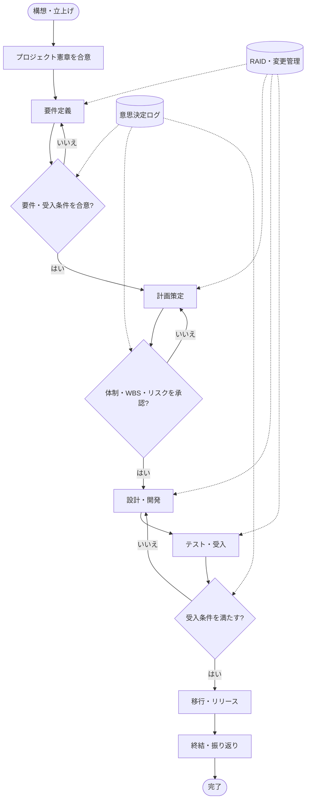
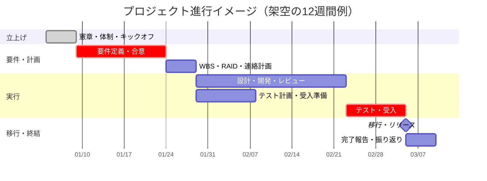
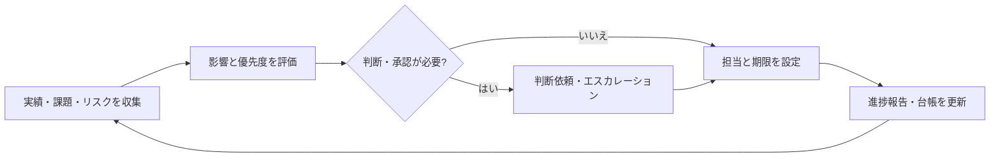

# プロジェクトフローとガントチャート

この図は、テンプレートを使う工程の全体像を示す架空の例です。案件の規模、契約、組織の規程に合わせて、工程・期間・承認者を調整してください。

## 工程フロー

工程ゲートでは、合意済みの事項だけでなく、条件付き承認の条件、未解決事項、判断者、判断日を[意思決定ログ](../templates/decision-log.md)に残します。スコープ・品質・費用・日程・体制に影響する変更は、実施前に[RAID・変更管理台帳](../templates/raid-change-log.md)で影響評価します。

## 標準的な進行イメージ

このガントチャートは説明用の基準線です。実際の計画では、WBSを基準に成果物、担当、依存関係、節目、完了条件を定義し、進捗報告では基準線との差異と対処案を示します。

## 定例での管理サイクル

定例では、状態の報告だけで終わらせず、次に必要な判断、担当者、期限を確定します。重大な差異は、[コミュニケーション計画](../templates/communication-plan.md)で定めた経路と期限に従ってエスカレーションします。
